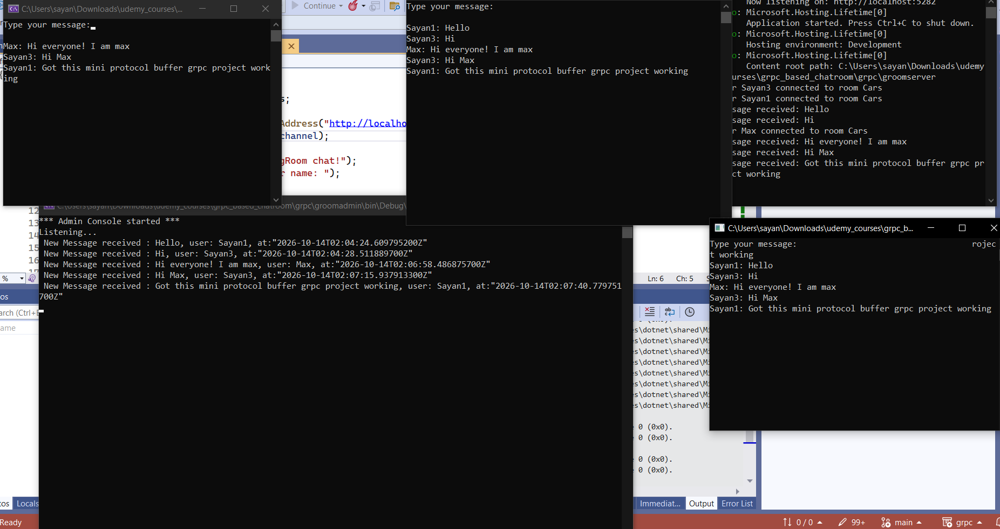
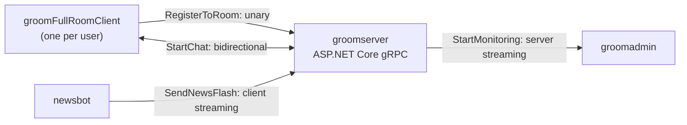
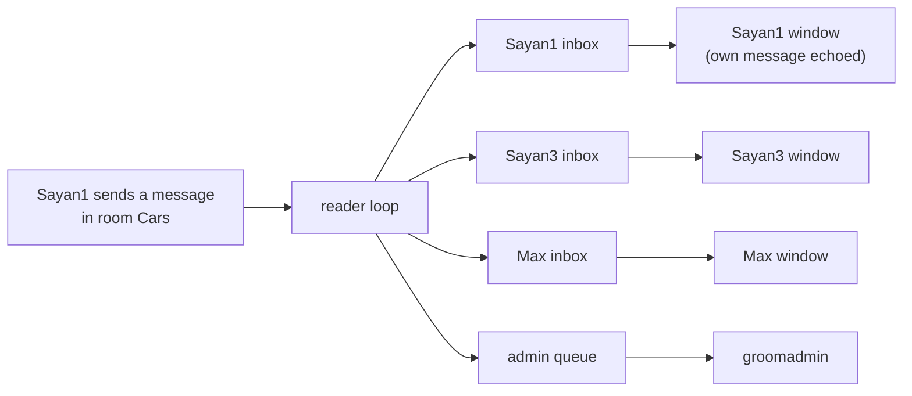
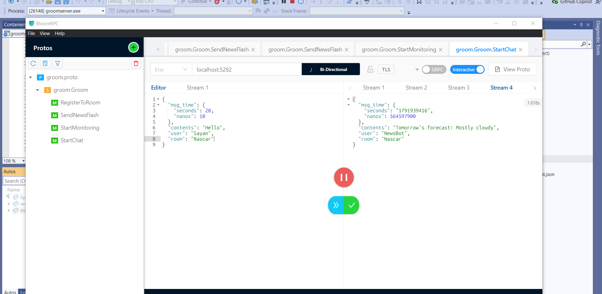

# gRoom: a gRPC chat room in .NET

A small chat room built to learn gRPC in .NET. One ASP.NET Core server, a chat client, an admin monitor and a news bot use all four gRPC call types between them: unary, client streaming, server streaming and bidirectional streaming. The chat client also connects over HTTPS, sends an `Authorization` header as call metadata, and sets a call deadline.



*Top right: server log. Bottom left: admin console. The other three windows are chat clients (Sayan1, Sayan3 and Max) in room `Cars`. Max joined last, so his window only shows messages sent after he registered.*

## At a glance

| RPC | Pattern | Called by | What happens |
| --- | --- | --- | --- |
| `RegisterToRoom` | Unary | `groomFullRoomClient` | Joins a room; the server creates an inbox for the user |
| `SendNewsFlash` | Client streaming | `newsbot` | Streams news items; the server replies once, when the stream ends |
| `StartMonitoring` | Server streaming | `groomadmin` | The server pushes chat messages from every room to the admin |
| `StartChat` | Bidirectional streaming | `groomFullRoomClient` | Sends your messages and receives the room's messages on one call |



The chat client connects over TLS to `https://localhost:7200`. The admin console uses plaintext HTTP/2 on `http://localhost:5282`.

## Project layout

| Folder | What it is |
| --- | --- |
| `groomserver/` | The gRPC server. `Services/GroomService.cs` implements all four RPCs; `Utils/` holds the in-memory queues. |
| `groomFullRoomClient/` | Console chat client: `RegisterToRoom`, then `StartChat`. |
| `groomadmin/` | Console admin monitor: `StartMonitoring`. |
| `newsbot/` | News publisher: streams to `SendNewsFlash`. |
| `groomClientApp/` | The first client, from the unary step (`RegisterToRoom` only). |
| `protobuf/` | Protobuf practice from before the gRPC parts. |
| `ProjectImages/` | Screenshots used in this README. |

The server runs on .NET 9 with `Grpc.AspNetCore` 2.64; `groomadmin` and `groomFullRoomClient` run on .NET 6 with `Grpc.Net.Client`. `Grpc.Tools` generates the C# stubs from the `.proto` at build time.

## The contract

The whole API is one service, defined in [`groomserver/Protos/groom.proto`](groomserver/Protos/groom.proto). The only difference between the four patterns is where the `stream` keyword goes:

```protobuf
service Groom {
  rpc RegisterToRoom  (RoomRegistrationRequest) returns (RoomRegistrationResponse); // unary
  rpc SendNewsFlash   (stream NewsFlash)        returns (NewsStreamStatus);         // client streaming
  rpc StartMonitoring (google.protobuf.Empty)   returns (stream ReceivedMessage);   // server streaming
  rpc StartChat       (stream ChatMessage)      returns (stream ChatMessage);       // bidirectional
}
```

Timestamps use the well-known `google.protobuf.Timestamp` type, and `StartMonitoring` takes `google.protobuf.Empty`.

`groomadmin` and `groomFullRoomClient` each keep a trimmed copy of this file with only the RPCs they call (the admin's copy has just `StartMonitoring`). That works because gRPC routes a call by its path (`/groom.Groom/StartMonitoring`) and protobuf matches fields by number, so a client only needs the parts it uses. The catch is that the copies have to be kept in sync by hand.

## How each call works

### Unary: `RegisterToRoom`

The client sends a room name and a user name. The server creates an in-memory inbox for that user and returns `joined = true`. This call also carries the auth header and a deadline, covered in [HTTPS, metadata and deadlines](#https-metadata-and-deadlines).

### Client streaming: `SendNewsFlash`

The news bot writes any number of `NewsFlash` messages, then completes its request stream. The server reads them in a `while (await newsStream.MoveNext())` loop, queues each one as a message from user `NewsBot`, and sends back a single `NewsStreamStatus { success = true }` once the stream is complete.

### Server streaming: `StartMonitoring`

The admin console sends an empty request and then only reads. The server never completes this stream. Once a second, it writes the next waiting message from the admin queue (which gets a copy of every chat message in every room) and from the news queue.

### Bidirectional streaming: `StartChat`

One call carries two independent streams. The client writes what you type to the request stream, and reads the room's messages from the response stream on a background task.

On the server, the first message on the stream is a handshake. It tells the server the user and room, and it isn't relayed to anyone. In the console client that first message is an empty line: the Enter you press at the "Press any key to enter the room" prompt is still in the input buffer, so the first `ReadLine()` returns `""`. After the handshake, two loops run side by side for each connection:



The reader loop copies each incoming message into the inbox of every member of the room, including the sender, and into the admin queue. The writer loop checks this user's inbox (and the news queue) every 200 ms and writes the next message to the response stream. The inbox is created by `RegisterToRoom`, so that call has to come before `StartChat`.

Typing `X` in the chat client cancels the call through a `CancellationTokenSource`. The client sees `StatusCode.Cancelled`, and the server's writer loop stops when `context.CancellationToken` fires.

The same call can be driven from a GUI client. Here BloomRPC has a `StartChat` stream open in room `Nascar`, and it receives a `NewsBot` message that another tab sent through `SendNewsFlash`:



## HTTPS, metadata and deadlines

### HTTPS

The chat client connects to `https://localhost:7200` using the ASP.NET Core development certificate. The admin console uses plaintext HTTP/2 on `http://localhost:5282`. That only works because Kestrel is set to HTTP/2-only in `appsettings.json` (`Kestrel:EndpointDefaults:Protocols` is `Http2`): without TLS there is no ALPN to negotiate the protocol, so the endpoint has to speak HTTP/2 from the first byte.

### Metadata

gRPC metadata is a set of key/value pairs sent as HTTP/2 headers with a call. The chat client sends a bearer token with `RegisterToRoom`, along with a 5-second deadline:

```csharp
var headers = new Grpc.Core.Metadata();
headers.Add("Authorization", "Bearer <token>");

var joinResponse = client.RegisterToRoom(
    new RoomRegistrationRequest { RoomName = room, UserName = username },
    deadline: DateTime.UtcNow.AddSeconds(5),
    headers: headers);
```

The token is a hard-coded placeholder and the server doesn't check it yet, so this shows the sending side of metadata rather than real authentication. On the server, the value is available as `context.RequestHeaders.GetValue("authorization")`; keys are lower-cased on the wire. Because metadata is ordinary HTTP/2 headers, the standard ASP.NET Core JWT bearer middleware and an `[Authorize]` attribute on `GroomService` would work with no gRPC-specific code.

### Deadlines

The deadline reaches the server as the `grpc-timeout` header. If the server takes longer, the client gets `StatusCode.DeadlineExceeded`, which it catches and reports. To see it, uncomment `await Task.Delay(10000);` in `GroomService.RegisterToRoom`.

## Running it locally

You need the .NET 9 SDK. `groomadmin` and `groomFullRoomClient` target `net6.0`, so either install the .NET 6 runtime or, since .NET 6 is out of support, change their `<TargetFramework>` to `net9.0`.

Trust the development certificate once, so the chat client can use HTTPS:

```bash
dotnet dev-certs https --trust
```

Then start each piece in its own terminal, from the repo root:

```bash
# Server: the https profile listens on https://localhost:7200 and http://localhost:5282
dotnet run --project groomserver --launch-profile https

# Admin console
dotnet run --project groomadmin

# Chat clients: start two or more and join the same room, e.g. Cars
dotnet run --project groomFullRoomClient

# News bot
dotnet run --project newsbot
```

The `--launch-profile https` flag matters. A plain `dotnet run` uses the first profile (`http`), which only listens on 5282, so the chat client can't reach 7200. In Visual Studio, choose the `https` profile.

In each chat client, enter a user name and a room, press Enter to go into the room, then type messages. Type `X` to cancel the chat stream.

To call the RPCs by hand instead, import `groomserver/Protos/groom.proto` into any gRPC GUI client (BloomRPC was used for the screenshot above) and point it at `localhost:5282`.

## Known limitations

This is a learning project, so all server state lives in static, in-memory collections. These are the shortcuts a reviewer will spot, with the production fix for each.

| Shortcut | Effect | Fix |
| --- | --- | --- |
| Static `Queue<T>` and `List<T>` shared by all calls, with no locking, polled every 200 ms or 1 s | Races between concurrent clients; added latency; at most one message per queue per tick | A `Channel<T>` per subscriber (`System.Threading.Channels`): thread-safe, and the writer awaits the next message instead of polling |
| One global news queue that every chat stream and the admin stream dequeue from | Each news item reaches one consumer, not everyone | Fan news out to every inbox, the way chat messages already are |
| Identity is the user name from the first `StartChat` message | Two clients with the same name compete for one inbox; a client whose first message is real text loses it | Send a user ID as call metadata, or take it from the auth token |
| `StartChat` and `StartMonitoring` never return, and inboxes are never removed | Handlers and queues outlive disconnected clients | Await the reader task, stop on `context.CancellationToken`, and unregister the user |
| The auth header is sent on one call and never validated | No real authentication yet | JWT bearer middleware with `[Authorize]`, plus `CallCredentials` on the channel so every call carries the token |